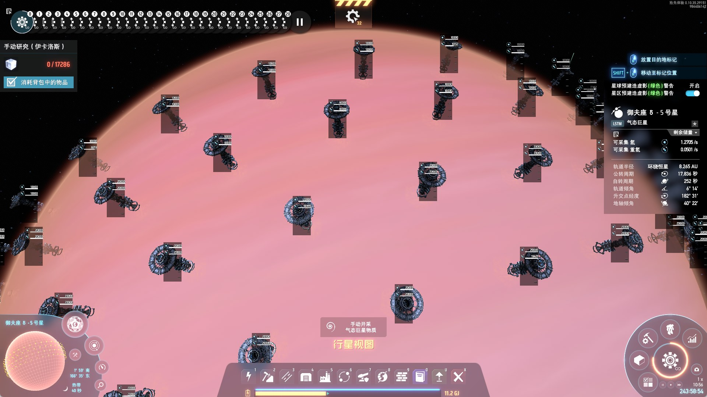

# 160 Orbital Collectors on One Gas Giant

**English** · [中文](README.zh-CN.md)

A ready-to-paste blueprint plus the arithmetic that shows *why* 160 orbital collectors fit on a single gas giant: **4 rings × 40 collectors**, captured in Dyson Sphere Program **0.10.35**.

> **40 is not the limit.** Four rings fit on one gas giant — here is the blueprint, the geometry proof, and what those 160 collectors actually produce.

| | |
|---|---|
| Collectors | **160** (item `2105`, model `117`) |
| Rings | 4 — latitudes **0.0° / 7.2° / 14.4° / 21.6°** |
| Per ring | **40**, every **9°** (10 grid cells) |
| Orbit radius | **220.2** world units (`localOffset_z = 15.0`) |
| Nearest-neighbour spacing | **32.13 – 32.58** units (mean 32.32) |
| Blueprint area | 1 area, 396 × 25 cells, 80 longitude segments |
| File | [`blueprints/160_orbital_collectors.txt`](blueprints/160_orbital_collectors.txt) |



*In game right after pasting — gas giant 御夫座 6 - 5 (Auriga 6-5), four rings of collectors around the equator. The translucent ones are still in the drone-construction (prebuild) stage.*

---

## 1. Requirements

* Dyson Sphere Program **0.10.35.x**
* **[BlueprintTweaks](https://thunderstore.io/c/dyson-sphere-program/p/kremnev8/BlueprintTweaks/)** with `bpOnGasGiants = true`

  Vanilla DSP refuses blueprints on gas giants: `BuildTool_BlueprintPaste.CheckBuildConditionsPrestage()` bails out with `EBuildCondition.Failure` as soon as `planet.gasItems != null` — i.e. on every gas giant. BlueprintTweaks patches exactly that method (its config key `bpOnGasGiants`, default `true`), which is what makes pasting this file possible at all.

  ```ini
  # BepInEx/config/org.kremnev8.plugin.BlueprintTweaks.cfg
  [Misc]
  bpOnGasGiants = true
  ```

The blueprint itself contains **nothing but orbital collectors** — no modded buildings, recipes or reform data — so it carries no other mod dependency.

## 2. Install

Copy the file into your blueprint folder (any sub-folder works):

```
%USERPROFILE%\Documents\Dyson Sphere Program\Blueprint\160 Orbital Collectors\
    160_orbital_collectors.txt
```

Re-open the in-game blueprint browser; the entry appears under the folder name.

## 3. Use

1. Fly to the gas giant you want to harvest.
2. Open the blueprint browser, pick **160 Orbital Collectors**.
3. Enter paste mode and aim at the **equator** of the planet.
4. Rotate if needed so the selection box runs **east–west**, then paste.

The game places 4 rings of 40; the first ring lands on the latitude you aim at, the other three step north from there.

---

## 4. The calculation

### 4.1 The gas-giant grid

| Quantity | Value |
|---|---|
| Planet radius `realRadius` | 200 |
| Longitude segments at the equator | 80 |
| Grid cells per segment | 5 |
| Cells per full circle | 80 × 5 = **400** |
| Angular width of one cell | 360° / 400 = **0.9°** |
| Latitude cell height | **0.9°** |
| Orbital altitude from the blueprint | `z = 15.0` |
| Orbit radius | `15.0 × 1.3333 + 0.2 + 200 =` **220.2** |

The game stores buildings in polar grid coordinates: `localOffset_x` = longitude cells, `localOffset_y` = latitude cells, and the radius is recovered with `r = localOffset_z × 4⁄3 + 0.2 + realRadius`. All 160 collectors carry `z = 15.0`, so **every one of them sits on the same 220.2 orbit shell**.

### 4.2 Why one ring holds exactly 40

An orbital collector may not be placed closer than **10 grid cells** (two "big grids", 5 cells each) to the next one on the same ring.

```
400 cells per circle
──────────────  = 40 collectors
 10 cells each
```

and in degrees: `40 × 9.0° = 360.0°` — the ring closes exactly, with no gap left over and no pair closer than the limit. **40 is the ring capacity, not a coincidence.**

### 4.3 Stacking rings: 4 × 40 = 160

Four rings are stacked 8 cells apart in latitude and offset by half a step from each other:

| Ring | Latitude | Lat. offset | First longitude | Step | Collectors |
|---|---|---|---|---|---|
| 1 | 0.0° | 0 cells | 0.0° | 9° | 40 |
| 2 | 7.2° | 8 cells | 4.5° | 9° | 40 |
| 3 | 14.4° | 16 cells | 0.0° | 9° | 40 |
| 4 | 21.6° | 24 cells | 4.5° | 9° | 40 |

8 cells = `8 × 0.9° = 7.2°` of latitude; the 5-cell (4.5°) shift between neighbouring rings is the whole trick explained below.

### 4.4 Distances — the actual proof

On a sphere of radius 220.2:

| Metric | Value (world units) |
|---|---|
| Ring 1 circumference | 1383.6 |
| Ring 2 circumference | 1372.6 |
| Ring 3 circumference | 1340.1 |
| Ring 4 circumference | 1286.4 |
| Spacing inside ring 1 / 2 / 3 / 4 | 34.55 / 34.28 / 33.47 / 32.13 |
| Minimum distance between ring 1↔2 / 2↔3 / 3↔4 | 32.58 / 32.43 / 32.15 |
| **Overall nearest neighbour** | **min 32.13, max 32.58, mean 32.32** |

**Why the half-step offset matters.** Without the 4.5° shift, the closest pair between two adjacent rings would be the straight north–south distance:

```
2 × 220.2 × sin(7.2° / 2) = 27.66
```

27.66 < 34.55, so the shell would be pinched between rings while being stretched inside them. Shifting every second ring by 5 cells turns the nearest cross-ring pair into the diagonal

```
Δlat = 7.2°, Δlon = 4.5°  →  32.58
```

and the whole shell becomes almost perfectly uniform — every collector is between 32.13 and 32.58 units from its closest neighbour. That uniformity is the design, not luck.

### 4.5 Totals

```
4 rings × 40 collectors   = 160 collectors
all at r = 220.2          → one orbital shell, no vertical interference
latitude span             = 0.0° … 21.6° (25 cells of the paste box)
```

### 4.6 What those 160 collectors actually produce

The engine derives a collector's output from the giant's own gas table (`PlanetTransport.cs`, `isCollectStation` branch):

```
perCollectorPerTick = gasSpeeds[i] / 60 × stationCollectSpeed × efficiency
efficiency          = 1 − workEnergyPerTick / (stationCollectSpeed × gasTotalHeat / 60)
```

`stationCollectSpeed` is 1 for the orbital collector, and the efficiency term sits at ≈ 1 on any giant with a normal heat output. The planet panel in-game reports `gasSpeeds` itself — i.e. **the per-collector rate**.

This giant (御夫座 6 - 5) reports **hydrogen 1.2275/s** and **deuterium 0.0510/s**:

| | 1 collector | 1 ring (40) | 4 rings (160) |
|---|---|---|---|
| Hydrogen | 1.2275 /s | 49.1 /s — 2,946 /min | **196.4 /s — 11,784 /min** |
| Deuterium | 0.0510 /s | 2.04 /s — 122 /min | **8.16 /s — 490 /min** |

Each ring is a clean quarter of the shell, so the fourth ring is not cosmetic — it is 25 % of the giant's output. A single ordinary giant becomes a ~11.8 k hydrogen/min and ~490 deuterium/min source.

---

## 5. Verify it yourself

The repository ships a dependency-free parser that reproduces every number above straight from the blueprint file:

```bash
python3 tools/analyze_blueprint.py blueprints/160_orbital_collectors.txt
```

```
file            : blueprints/160_orbital_collectors.txt
payload version : 2
areas           : [{'index': 0, 'parent': -1, 'tropic_anchor': 0, 'segments': 80, 'anchor_x': 0, 'anchor_y': 0, 'width': 396, 'height': 25}]
buildings total : 160 | collectors: 160
item ids        : [2105]
orbit radius    : 220.200  (z offset 15.000, real radius 200.0)
grid            : 0.900 deg/cell, 400 cells per circle

rings:
  lat(deg)  count  first lon  step   circumference  neighbour
     -0.0     40      0.00   [9.0]        1383.6     34.55
      7.2     40      4.50   [9.0]        1372.6     34.28
     14.4     40      0.00   [9.0]        1340.1     33.47
     21.6     40      4.50   [9.0]        1286.4     32.13

nearest-neighbour distance: min 32.127  max 32.577  mean 32.323
ring-to-ring minimum     : ['32.58', '32.43', '32.15']
```

Add `--csv positions.csv` for per-collector coordinates, `--json summary.json` for the machine-readable summary.

## 6. Repository layout

```
blueprints/160_orbital_collectors.txt   the blueprint (verbatim game export)
data/positions.csv                      all 160 collectors: ring, lat, lon, unit vector, xyz
data/rings.json                         parsed summary (areas, ring stats, distances)
tools/analyze_blueprint.py              parser + geometry report, stdlib only
docs/img/ingame-gas-giant.jpg           in-game screenshot (placement proof)
README.md                               this file
README.zh-CN.md                         中文说明
```

## 7. Caveats

* **Verified in game.** The file was copied from a live save and pasted back onto a gas giant (御夫座 6 - 5) in 0.10.35 — the screenshot at the top is the result: 160 collectors standing in 4 rings.
* BlueprintTweaks is **mandatory, not optional**. The engine itself refuses blueprints on gas giants (`planet.gasItems != null` → `EBuildCondition.Failure`). Keep `bpOnGasGiants = true`.
* Community wikis still state "equatorial only, 40 per giant". Treat that as a description of the plain one-ring layout, not as an engine limit — the file in this repo proves four rings fit.
* All 160 collectors carry the same orbit radius (220.2), so nothing is stacked vertically and no ring shadows another.

## License

MIT — see [LICENSE](LICENSE).
